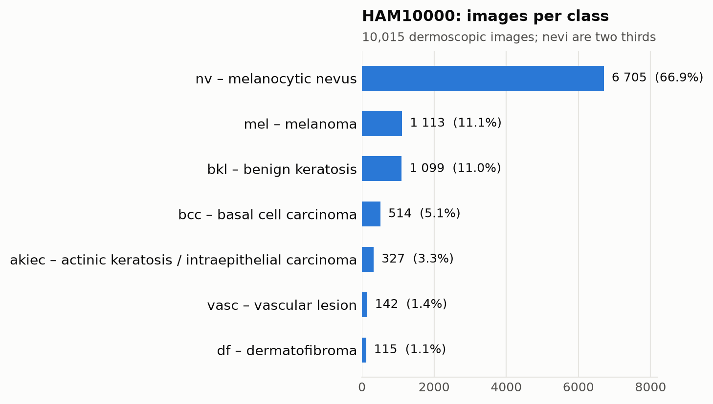
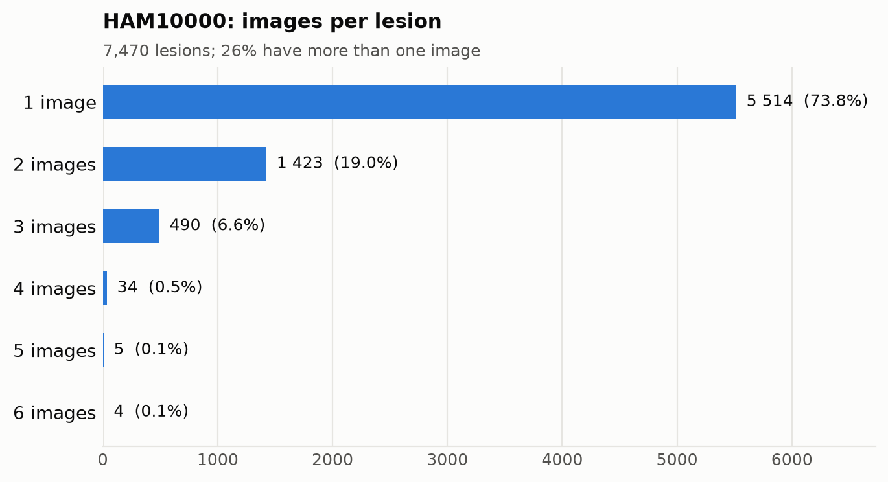
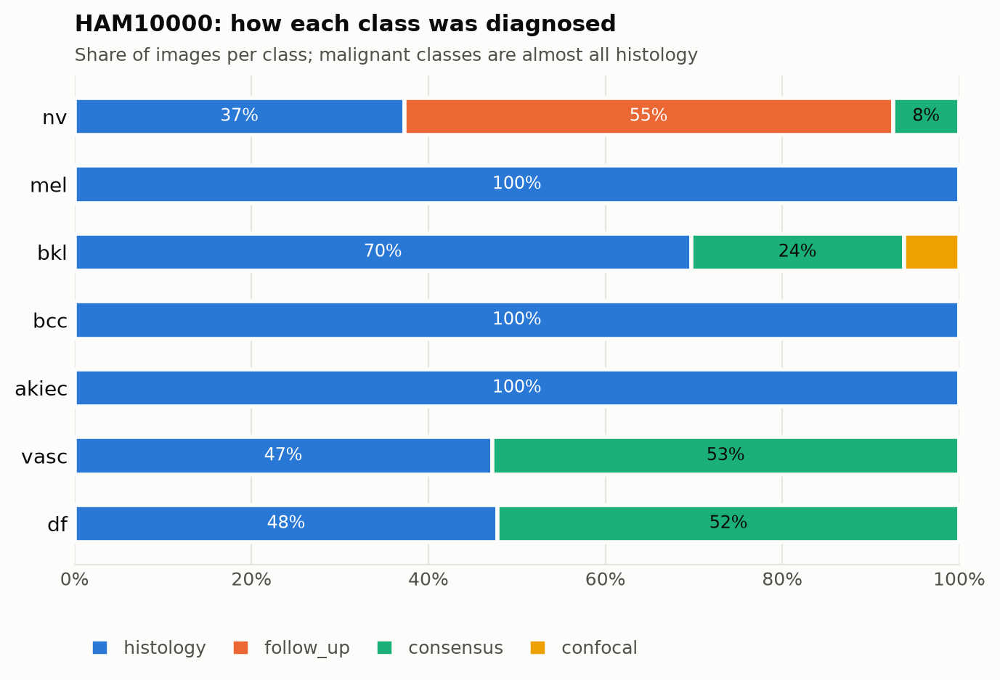
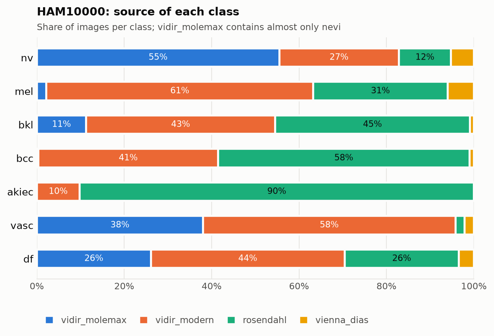
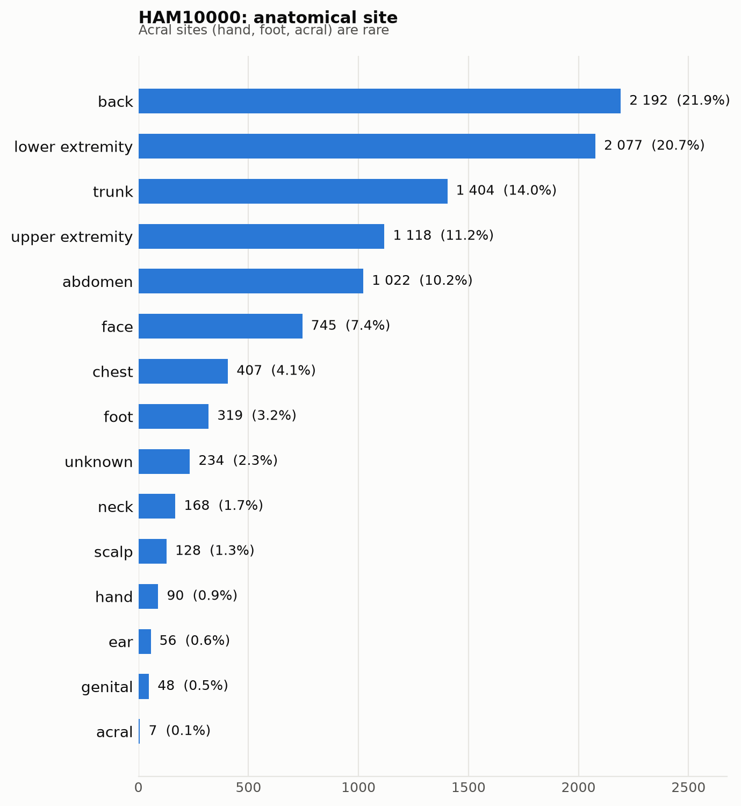
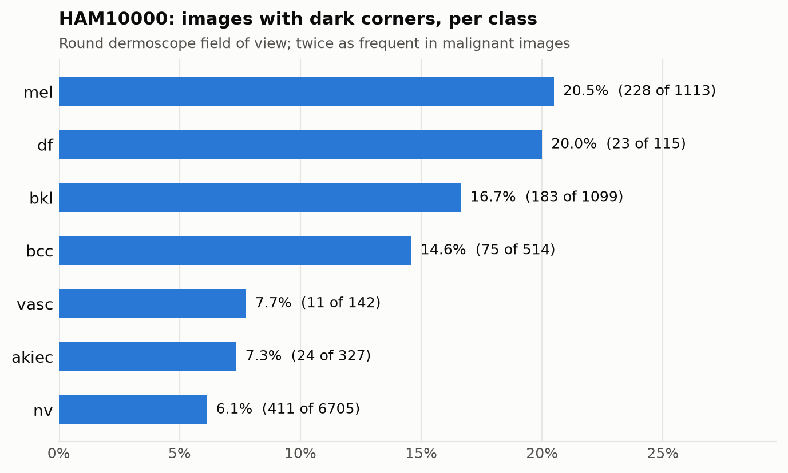

# 11 — EDA di HAM10000 e divisione per lesione

> Analisi esplorativa del dataset di addestramento (pacchetto M2-P3, issue #13), fatta il 2026-11-14.
> Si rifà con il notebook [`ml/notebooks/01_eda_ham10000.ipynb`](../ml/notebooks/01_eda_ham10000.ipynb); i numeri vengono dal registro dati.
> Il controllo degli artefatti (§7) è del 2026-11-17.

## In breve
- **Squilibrio forte:** i nevi sono il 67% delle immagini; la classe più grande è 58 volte la più piccola. Per questo si usa l'accuratezza bilanciata.
- **Una lesione su quattro ha più immagini:** la divisione va fatta per lesione, non per immagine.
- **Etichette affidabili per i tumori:** melanomi, basocellulari e `akiec` sono tutti confermati dall'istologia; i nevi lo sono solo per il 37%.
- **Classe e centro sono legati:** il 90% delle `akiec` viene dall'Australia, e una raccolta di Vienna contiene quasi solo nevi. Il modello potrebbe imparare il centro invece della lesione.
- **Bordo nero del dermatoscopio:** è nel 9,5% delle immagini, viene quasi tutto da una sola raccolta ed è due volte più frequente nelle immagini maligne. È una possibile scorciatoia.
- **MONET sulle dermoscopie:** riconosce bene i peli, non penna, righello, adesivo e bolle.
- **Nessun duplicato tra lesioni diverse:** la divisione per `lesion_id` basta a evitare fughe tra training e test.
- **Divisione pubblicata:** 7.005 / 1.509 / 1.501 immagini (training / validazione / test), in [`ml/splits/ham10000_lesion_v1.csv`](../ml/splits/ham10000_lesion_v1.csv).

## 1. Classi e squilibrio

| Classe | Immagini | Quota |
|--------|---------:|------:|
| `nv` nevo melanocitico | 6.705 | 66,9% |
| `mel` melanoma | 1.113 | 11,1% |
| `bkl` cheratosi benigna | 1.099 | 11,0% |
| `bcc` carcinoma basocellulare | 514 | 5,1% |
| `akiec` cheratosi attinica / carcinoma intraepiteliale | 327 | 3,3% |
| `vasc` lesione vascolare | 142 | 1,4% |
| `df` dermatofibroma | 115 | 1,1% |

Un modello che rispondesse sempre "nevo" avrebbe il 67% di accuratezza e non troverebbe nessun tumore.

Le immagini **maligne** (`mel`, `bcc`, `akiec`) sono 1.954, il 19,5%. ⚠️ Contare `akiec` tra le maligne segue Tschandl 2020 ed è ancora da confermare.

## 2. Immagini per lesione

- 7.470 lesioni per 10.015 immagini.
- 1.956 lesioni (26%) hanno più di un'immagine, fino a 6; insieme fanno 4.501 immagini, il 45% del dataset.
- Dividendo per immagine, quasi metà del dataset rischierebbe di avere "la stessa lesione" sia nel training sia nel test.

## 3. Quanto sono affidabili le etichette

| Fonte della diagnosi | Immagini | Quota |
|----------------------|---------:|------:|
| Istologia | 5.340 | 53,3% |
| Follow-up (lesione stabile nel tempo) | 3.704 | 37,0% |
| Consenso di esperti | 902 | 9,0% |
| Microscopia confocale | 69 | 0,7% |

- `mel`, `bcc` e `akiec`: 100% istologia.
- `nv`: 37% istologia, 55% follow-up, 8% consenso.
- `vasc` e `df`: circa metà istologia, metà consenso.

**Conseguenza:** gli errori sui tumori si misurano contro etichette solide. I nevi con istologia sono quelli che un medico ha deciso di asportare, quindi probabilmente i più dubbi: conviene riportare i risultati anche solo sulle immagini con istologia.

## 4. Da dove vengono le immagini

| Raccolta | Paese | Immagini | Nota |
|----------|-------|---------:|------|
| `vidir_molemax` | Austria | 3.954 | 94% nevi; nessuna `akiec`, 2 `bcc` |
| `vidir_modern` | Austria | 3.363 | la più varia; 61% dei melanomi |
| `rosendahl` | Australia | 2.259 | 90% delle `akiec`, 58% dei `bcc` |
| `vienna_dias` | Austria | 439 | diapositive digitalizzate; 80% nevi |

**Rischio di scorciatoia:** se le immagini di una raccolta hanno un aspetto riconoscibile (colore, risoluzione, bordo), il modello può indovinare la classe dal centro. Va controllato in due modi:
1. con il controllo degli artefatti di MONET (§7);
2. riportando i risultati **per centro** nelle baseline (pacchetto P4).

## 5. Pazienti e sedi
| Dato | Mancante |
|------|---------:|
| Età | 57 (0,6%) |
| Sesso | 57 (0,6%) |
| Sede anatomica | 234 (2,3%) |
| Identificativo del paziente | tutti |
| Fototipo | tutti |

- **Sesso:** 5.406 uomini, 4.552 donne.
- **Età mediana per classe:** nevi 45 anni; dermatofibromi 50; vascolari 55; melanomi 60; cheratosi benigne 65; basocellulari e `akiec` 70.
- **Sedi più frequenti:** schiena (2.192), arto inferiore (2.077), tronco (1.404), arto superiore (1.118), addome (1.022).
- **Sedi acrali:** piede 319, mano 90, "acral" 7. Poche: per la RQ6 servono BALD e gli altri dataset del pacchetto P5.

**Limite per la RQ6:** HAM10000 non pubblica né il fototipo né il paziente. L'equità per tono della pelle si può misurare solo sui dataset esterni.

**Attenzione all'età:** i nevi sono molto più giovani dei tumori. Un modello che usasse l'età indovinerebbe spesso; noi usiamo solo l'immagine.

## 6. Duplicati
Metodo: ogni immagine è ridotta a una miniatura 32 × 32 a colori; due immagini sono una coppia se le miniature differiscono in media di meno di 3 livelli su 255.

| Risultato | Coppie |
|-----------|-------:|
| Coppie quasi identiche | 17 |
| di cui file identici (stesso checksum) | 2 |
| dentro la stessa lesione | 17 |
| **tra lesioni diverse** | **0** |

Le 17 coppie stanno tutte dentro una stessa lesione, quindi finiscono nella stessa parte della divisione.

Un primo tentativo con un'impronta più grossolana (dHash 8 × 8) è stato scartato: segnalava migliaia di coppie tra immagini diverse, anche con diagnosi diverse, perché le dermoscopie si somigliano tutte (una macchia al centro).

⚠️ Questo metodo trova solo immagini quasi uguali pixel per pixel. La stessa lesione fotografata due volte con un'altra inquadratura sfugge: va ricontrollato con i vettori dei backbone nel pacchetto P4.

## 7. Artefatti
Si rifà con `neo-data artifacts ham10000`. Due strumenti:
- **MONET**, che dà a ogni immagine un punteggio per un concetto descritto a parole (formula del tutorial degli autori);
- una **misura sui pixel** per il bordo nero.

### 7.1 MONET regge sulle dermoscopie? Controllo a occhio
Per ogni concetto ho guardato le 24 immagini con il punteggio più alto. È un giudizio mio su 24 immagini, non una misura: ⚠️ va rifatto da un dermatologo su un campione più grande.

| Concetto | Parole usate | Cosa c'è davvero tra le prime 24 | Si può usare? |
|----------|--------------|----------------------------------|---------------|
| Peli | "hair" | Peli evidenti in quasi tutte | Sì, con cautela |
| Righello | "ruler", "measurement scale bar" | Una scala graduata in 5–6; il resto sono lesioni con trama a griglia | No |
| Penna | "purple pen", "pen marking" | Segni di penna in 2–3; il resto sono lesioni vascolari viola o rosa | No |
| Adesivo | "orange sticker", "sticker" | Nessun adesivo; lesioni tonde gialle o rosse | No |
| Bordo nero | "black border", "dark corners" | Bordo nero in 2–3; il resto sono lesioni scure | No |
| Bolle | "air bubbles", "gel bubbles" | Bolle in 1–2 | No |

**Cosa se ne ricava:**
- MONET confonde il **colore della lesione** con l'artefatto: "penna viola" trova le lesioni vascolari, "bordo nero" trova i nevi scuri. Usarlo così creerebbe un falso legame tra artefatto e classe.
- È la prima risposta alla domanda aperta della M1 ("MONET legge le dermoscopie?"): per gli artefatti, **solo in parte**. Per i criteri dermoscopici la verifica vera resta quella su Derm7pt e sulle annotazioni di Chanda (M3.4).
- Penna, righello, adesivo e bolle restano **non misurati**. Servirebbe un campione annotato a mano (la checklist degli artefatti di [`05`](05_scelte_e_pipeline.md) §5.2).

Anche per i peli il punteggio va preso con cautela: sopra 0,7 quasi tutte le immagini guardate hanno peli; tra 0,6 e 0,7 circa 9 su 24; tra 0,5 e 0,6 circa 3 su 24. Con la soglia a 0,7 si trovano 766 immagini (7,6%), ma non so quante ne sfuggono.

### 7.2 Bordo nero, misurato sui pixel
Misura: quota di pixel scuri (sotto 50 su 255) nei quattro angoli dell'immagine. Un'immagine "ha il bordo nero" se la quota supera il 5%. Controllo a occhio: tutte le 48 immagini guardate sopra la soglia avevano il campo rotondo del dermatoscopio.

| Raccolta | Immagini | Con bordo nero | Quota |
|----------|---------:|---------------:|------:|
| `vidir_modern` | 3.363 | 870 | 25,9% |
| `rosendahl` | 2.259 | 80 | 3,5% |
| `vidir_molemax` | 3.954 | 3 | 0,1% |
| `vienna_dias` | 439 | 2 | 0,5% |
| **Totale** | **10.015** | **955** | **9,5%** |

| | Immagini | Con bordo nero |
|---|---------:|---------------:|
| Benigne | 8.061 | 7,8% |
| Maligne | 1.954 | 16,7% |

- Il **91%** dei bordi neri viene da `vidir_modern`, la raccolta con il 61% dei melanomi.
- Il legame con la malignità è in gran parte un effetto del centro, ma **non solo**: dentro `vidir_modern` il bordo nero è nel 31,7% delle maligne e nel 23,6% delle benigne.
- Le classi più colpite: melanoma 20,5%, dermatofibroma 20,0%, cheratosi benigna 16,7%, basocellulare 14,6%; i nevi 6,1%.
- Nelle tre parti della divisione la quota è simile: 9,4% / 9,9% / 9,9%.

**Conseguenza per le baseline:** un modello può imparare "bordo nero = più probabile tumore". Nel pacchetto P4 riporto i risultati separati per immagini con e senza bordo nero, e per centro. Il ritaglio sulla lesione (M3.2) dovrebbe ridurre il problema.

### 7.3 Peli (MONET, soglia 0,7)
| | Quota con peli |
|---|---------------:|
| Benigne | 8,6% |
| Maligne | 3,8% |
| `vidir_molemax` | 11,8% |
| `rosendahl` | 7,1% |
| `vidir_modern` | 4,0% |
| `vienna_dias` | 1,4% |

I peli sono più frequenti nei nevi (8,9%) e rari nei melanomi (2,1%). ⚠️ Numeri indicativi, per i limiti detti sopra.

## 8. La divisione per lesione
70% / 15% / 15% delle **lesioni**, stratificata per diagnosi, seme 2026.

| Classe | Training | Validazione | Test |
|--------|---------:|------------:|-----:|
| `akiec` | 238 | 41 | 48 |
| `bcc` | 351 | 76 | 87 |
| `bkl` | 777 | 161 | 161 |
| `df` | 81 | 15 | 19 |
| `mel` | 785 | 166 | 162 |
| `nv` | 4.675 | 1.030 | 1.000 |
| `vasc` | 98 | 20 | 24 |
| **Immagini** | **7.005** | **1.509** | **1.501** |
| **Lesioni** | **5.229** | **1.120** | **1.121** |

Controlli superati:
- ogni immagine compare una volta sola;
- nessuna lesione sta in due parti;
- tutte le 7 classi sono in ogni parte;
- quota di maligne simile: 19,6% / 18,8% / 19,8%;
- quota per centro e per fonte della diagnosi simile nelle tre parti.

**Regole d'uso:**
- il file è pubblicato nel repository e **non si rigenera**: il comando rifiuta di sovrascriverlo;
- il **test si usa una volta sola**, alla fine; le scelte si fanno sulla validazione;
- le classi piccole hanno pochi casi nel test (19 `df`, 24 `vasc`, 48 `akiec`): gli intervalli di confidenza per classe saranno larghi, e vanno sempre riportati.
